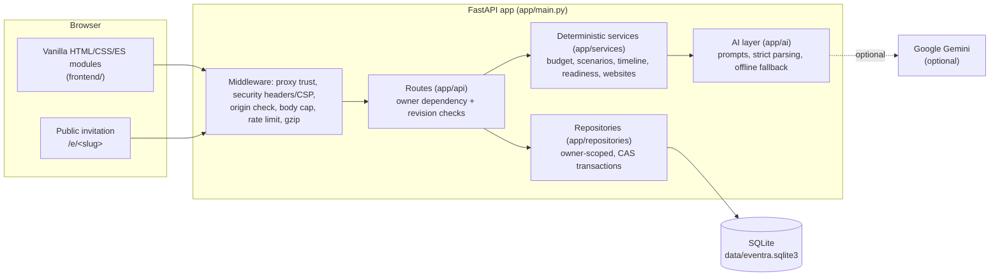

# Planora AI

**A GenAI-powered Celebration & Event Planner for weddings, birthdays and community events.** Planora turns a few details about an occasion into a saved, editable plan with an exact-cent budget, a dated timeline, vendor checklists and personalized ideas. The plan then follows the event from guest list to event day.

> Numbers and approvals belong to the server. Gemini adds optional narrative and validated suggestions. It can never change authoritative money, bypass ownership or apply a change without explicit user approval. Without an API key, a deterministic offline planner provides the full workflow.

## 1. Problem statement

The Challenge 5 statement supplied by the project owner:

> *"Create a GenAI-powered planning assistant that helps users organize weddings, birthdays, and community events with budgets, timelines, vendor checklists, and personalized ideas."*

**The problem.** People planning a celebration juggle a budget, a schedule, suppliers, guests and ideas across spreadsheets, chats and notes. Generic AI chat gives fluent advice but no saved plan, and its arithmetic can be wrong. Basic planner apps store lists but don't connect a vendor cancellation or a guest-count change back to the budget and the timeline.

**How Planora solves it.** Every event lives in one persistent workspace. A deterministic engine computes the budget, timeline and vendor checklist, so the numbers are always reproducible. AI adds personalization and explanation on top of that verified core. Every change that affects money or the plan is first shown as an isolated preview and applied only after explicit approval.

### Requirement → feature → evidence

| Problem-statement requirement | Planora AI feature | Implementation evidence |
| --- | --- | --- |
| GenAI-powered planning assistant | Gemini narrative, natural-language intake, grounded Q&A, decision/design/readiness suggestions, negotiation and invitation copy, with an offline fallback for each | [app/ai/](app/ai/) (`gemini.py`, `intake.py`, `workspace.py`, `negotiation.py`, `website_copy.py`, `command_center.py`); [tests/security/test_ai_boundaries.py](tests/security/test_ai_boundaries.py) |
| Weddings, birthdays and community events | Event types `wedding`, `birthday`, `community` (plus anniversary and baby shower); a five-step wizard and reviewed free-text intake | [app/schemas/planning.py](app/schemas/planning.py) (`EventType`); [app/services/engine.py](app/services/engine.py); [frontend/modules/wizard.js](frontend/modules/wizard.js) |
| Budgets | Category allocation (largest-remainder), Budget Guardian expense ledger with exact-cent Decimal/HALF_UP accounting, scenario and rescue previews | [app/services/budget.py](app/services/budget.py), [app/services/scenarios.py](app/services/scenarios.py); [docs/BUDGET_RULES.md](docs/BUDGET_RULES.md); [tests/integration/test_budget.py](tests/integration/test_budget.py) |
| Timelines | Dated milestones and checklists, calendar/print export, delay analysis and the Event Day Command Center | `build_timeline` in [engine.py](app/services/engine.py); [app/services/timeline_intelligence.py](app/services/timeline_intelligence.py), [app/services/command_center.py](app/services/command_center.py) |
| Vendor checklists | Vendor checklist generated per category, vendor records and arrivals, Quote Analyzer, Negotiation Assistant | `build_vendors` in [engine.py](app/services/engine.py); [app/services/quote_analysis.py](app/services/quote_analysis.py), [app/services/negotiation.py](app/services/negotiation.py) |
| Personalized ideas | Event-type ideas tailored to guests, formality and budget; optional Gemini narrative; Design Studio mood boards; invitation website themes | `ideas` in [engine.py](app/services/engine.py); [app/services/design.py](app/services/design.py); [app/services/websites.py](app/services/websites.py) |

**Beyond the statement**, Planora adds features that keep the plan useful after day one: a Guest List & RSVP Manager, Scenario Studio and Event Rescue (what-if previews with approval), Event Readiness checks, and an approved public invitation website with RSVP.

## 2. Key features

| Feature | What it does |
| --- | --- |
| **Event creation** | Five-step wizard or reviewed natural-language intake. |
| **Budget Guardian** | Editable expenses and category allowances; estimates, quotes, commitments and payments tracked to the cent; missing-price and exposure warnings. |
| **Timeline & checklists** | Dated milestones, planning and vendor checklists, calendar (.ics) and print export, read-only delay analysis. |
| **Guest List & RSVP Manager** | Up to 500 guests per event, groups, four RSVP states, plus-ones, dietary and accessibility notes, search, live totals. |
| **Vendor Negotiation Assistant** | Seven quote-grounded request types, editable and copyable messages, saved versioned drafts. Nothing is sent automatically. |
| **Quote Analyzer** | Labelled text quotes reconciled exactly, with source evidence and up to three comparisons. |
| **Scenario Studio & Event Rescue** | Six isolated what-if types (budget cut, guest count, date, supplier cancellation, cost change, extra function). Compare, discard or approve. |
| **Event Readiness** | Fourteen pass / attention / unknown evidence checks across five dimensions, with three linked next actions. |
| **Event Day Command Center** | Task status and owners, vendor arrivals, incidents, activity history, transparent readiness, read-only grounded copilot. |
| **Event Website & Invitation** | Four themes, private draft, real preview, explicit publish approval, unlisted `/e/<slug>` link, update/unpublish, optional public RSVP into the guest list. |
| **Design Studio** | Mood-board recipes, editable palette, a saved preferred concept. |
| **Cinematic landing page** | CSS 3D / WebGL2 scroll sequence with static fallbacks for reduced motion, data saving and unsupported devices. |

## 3. How it works

1. **Describe the occasion.** Use the wizard or plain language ("a 120-guest wedding in Jaipur in March, ₹15 lakh"). Planora shows the extracted fields for review before anything is saved.
2. **Get a verified plan.** The deterministic engine builds the budget, timeline, vendor checklist and ideas. If Gemini is configured, it adds narrative and personalized suggestions, validated against strict schemas.
3. **Manage the event.** Record real expenses and quotes, manage guests, draft vendor negotiations and design the invitation.
4. **Ask "what if?"** Scenarios and Rescue options are computed as isolated previews. Nothing changes until you approve a feasible, current proposal.
5. **Run the day.** The Command Center tracks tasks, arrivals and incidents. The published invitation collects RSVPs.

Events are saved in SQLite and scoped to the browser through an anonymous HttpOnly owner cookie, so no signup is needed.

## 4. Architecture



```text
app/
  main.py          ASGI entry point, middleware and router composition
  api/             HTTP routes, ownership/revision dependencies, error handlers
  core/            configuration, body limits, proxy trust, rate limits, TTL cache
  schemas/         Pydantic request/response and domain models
  services/        deterministic planning, exact budget, scenarios, Rescue, readiness
  ai/              Gemini transport and prompts, strict output parsing, offline paths
  db/              SQLite connections and migrations
  repositories/    owner-scoped persistence, compare-and-swap transactions
frontend/          index.html, app.js, modules/, styles/, assets/ (no build step)
tests/             unit/, integration/, security/, browser/, fixtures/
scripts/           structure/contract checks, offline AI evaluations, release audit
docs/              specifications, audits and demo guides (see docs/README.md)
```

**Technology stack:** Python 3.11+, FastAPI, Pydantic v2, Uvicorn, SQLite (standard library), optional `google-genai` (Gemini 2.5 Flash by default), vanilla JavaScript ES modules and CSS. There is no frontend framework, npm dependency or bundler.

## 5. The role of AI

| Used for | Not used for |
| --- | --- |
| Personalized narrative and ideas on top of the computed plan | Any budget, allocation or exact-cent calculation |
| Extracting event details from free text, which the user then reviews | Applying scenarios, approvals or publication |
| Grounded answers about the saved plan | Ownership, authorization or revision checks |
| Ordering validated decision, design and readiness actions | Inventing prices, savings or supplier confirmations |
| Negotiation tactics and tone, invitation copy variants | Sending messages or invitations |

Safeguards: user data and system instructions are sent in separate roles; context and output are size-bounded; responses must match strict server-defined schemas and allowed action IDs; prompt and key echoes are rejected; repeated requests are served from a TTL cache; any failure falls back to deterministic output. Imported quote text and the guest roster are never sent to the provider. These controls reduce, but do not eliminate, prompt-injection and narrative-accuracy risk.

## 6. Setup and running

Requirements: Python **3.11+** (verified locally on CPython 3.14.2, Windows). Node.js is only needed for the JavaScript and browser checks. A Gemini key is optional.

**Windows PowerShell**

```powershell
py -3 -m venv .venv
.\.venv\Scripts\python -m pip install -r requirements-dev.txt
.\.venv\Scripts\python -m uvicorn app.main:app --reload --no-proxy-headers
```

**macOS / Linux**

```sh
python3 -m venv .venv
. .venv/bin/activate
python -m pip install -r requirements-dev.txt
python -m uvicorn app.main:app --reload --no-proxy-headers
```

Open **http://127.0.0.1:8000/**. Health: `/healthz`. API docs: `/api/docs`. OpenAPI: `/api/openapi.json`. Use `requirements.txt` for runtime only. [requirements-ci.txt](requirements-ci.txt) pins the exact Windows/Python 3.14.2 snapshot used by CI.

### Environment variables

The app reads process environment variables and does **not** auto-load `.env`. Copy [.env.example](.env.example) to the git-ignored `.env` and launch with `--env-file .env`, or export the variables in your shell. Never commit a real key.

| Variable | Default and behavior |
| --- | --- |
| `GEMINI_API_KEY` (alias `GOOGLE_API_KEY`) | Empty means deterministic offline mode. Set only one. |
| `GEMINI_MODEL` / `GEMINI_TIMEOUT_MS` | `gemini-2.5-flash` / `20000` |
| `EVENTRA_DB_PATH` | `<project>/data/eventra.sqlite3`. Use an absolute durable path when deployed. |
| `RATE_LIMIT` / `RATE_WINDOW` / `RATE_MAX_CLIENTS` | `30` requests / `60` s / `10000` clients. `RATE_LIMIT × RATE_MAX_CLIENTS` must be ≤ 1,000,000. |
| `TRUSTED_PROXY_CIDRS` | Empty means only the socket peer is trusted. Explicit IPs/CIDRs only; keep `--no-proxy-headers`. |
| `LOG_LEVEL` | `INFO`. Provider failures log exception classes, never credentials or raw output. |
| `K_SERVICE` / `PORT` | When `K_SERVICE` is set (Cloud Run), saved-workspace APIs fail closed. `PORT` is used by the Docker command (default 8080). |

Startup preserves the existing database and migrates supported older data transactionally. It never resets a database. Back up with SQLite's backup API or stop the server before copying the file.

## 7. Testing

```powershell
.\.venv\Scripts\python -m pytest --cov --cov-report=term-missing --cov-fail-under=90
.\.venv\Scripts\python -m ruff check app tests scripts
.\.venv\Scripts\python -m ruff format --check app tests scripts
.\.venv\Scripts\python -m scripts.check_structure
.\.venv\Scripts\python -m scripts.evaluate_planning      # also: evaluate_intelligence, evaluate_readiness
node tests/browser/test_money_display.mjs
node tests/browser/browser_workspace_smoke.mjs .venv/Scripts/python.exe
```

- The tests are deterministic and need **no Gemini key**. AI paths are exercised with injected fake clients, timeouts, malformed output and quota errors.
- Each test uses temporary databases. The browser harness starts its own Uvicorn server with a temporary database and browser profile, and needs Edge or Chrome (set `EVENTRA_BROWSER_BINARY` or pass the path as a third argument).
- Coverage is combined statement and branch coverage over `app/`, with a 90% floor enforced.
- The suite covers unit, integration, security (ownership isolation, CSRF/origin, body limits, proxy spoofing, AI boundaries), public RSVP, publish and unpublish, exact-cent budgets, Event Day workflows and regressions for previously fixed defects.

Current measured results are recorded in [docs/REPOSITORY_EVALUATION_READINESS.md](docs/REPOSITORY_EVALUATION_READINESS.md). The previous full audit is in [docs/FINAL_AUDIT.md](docs/FINAL_AUDIT.md).

## 8. Demo walkthrough (about 5 minutes, offline)

1. Start the server and open the landing page. Scroll the cinematic sequence, or turn on reduced motion to see the static fallback.
2. Click **Try the full saved demo** and acknowledge that the data is fictional. A separate demo workspace is created.
3. **Overview:** review the Readiness evidence, the unknowns and the three next actions.
4. **Budget:** edit an expense and watch the exact-cent totals and warnings update.
5. **Scenarios / Rescue:** preview a guest-count change or a supplier cancellation, compare it, then approve it. Reload to confirm it persisted.
6. **Guests:** add guests and RSVPs. **Vendors:** generate and save a negotiation draft from a quote.
7. **Event Website:** pick a theme, preview it, approve publication, then open the `/e/<slug>` link in a private window and submit an RSVP. It appears in the guest list. Unpublish to revoke the link.
8. **Event Day:** update task statuses, log a vendor arrival and an incident.

Further guides: [core demo](docs/JUDGE_DEMO.md), [intelligence workflows](docs/INTELLIGENCE_DEMO.md), [readiness demo](docs/READINESS_DEMO.md).

## 9. Security and privacy

- **Anonymous ownership:** a random 32-byte owner token sits in an HttpOnly, SameSite=Strict cookie (Secure over HTTPS). Only its one-way hash is stored. Every private route uses an owner dependency; an event UUID alone grants no access.
- **Request protection:** same-origin checks on state-changing requests, a 20,000-byte request cap, a bounded process-local rate limiter, and forwarding headers honored only from explicitly trusted proxies.
- **Headers:** a strict Content-Security-Policy, `nosniff`, `X-Frame-Options: DENY`, `no-referrer`, a restrictive Permissions-Policy, `Cross-Origin-Opener-Policy` and `Cross-Origin-Resource-Policy: same-origin`, HSTS on HTTPS responses, and `no-store` on workspace responses. Swagger UI is self-hosted so the CSP stays strict.
- **Data handling:** parameterized SQL only; the frontend renders user and model text as text nodes, never as HTML. Public invitation pages serve only an allowlisted, owner-approved snapshot.
- **Secrets:** `.env`, databases, keys, logs and backups are git-ignored; `.env.example` holds placeholders only. Report vulnerabilities as described in [SECURITY.md](SECURITY.md).

### Accessibility

- Semantic landmarks (one `main` per view), skip links, labelled form controls, live regions for status and errors, and keyboard-operable tabs, menus and dialogs, with visible `:focus-visible` outlines.
- Text colours meet WCAG AA contrast (4.5:1, or 3:1 for large text). [tests/integration/test_accessibility.py](tests/integration/test_accessibility.py) checks the shared design tokens.
- `prefers-reduced-motion` and data-saving modes replace the 3D/WebGL landing sequence with static artwork, and decorative glyphs are hidden from screen readers.
- Swagger UI at `/api/docs` gets local contrast overrides, named expand buttons and corrected heading levels.

## 10. Limitations

- Saved events need **one instance with durable SQLite storage**. Serverless and ephemeral containers are not supported (Cloud Run fails closed), and Vercel is not verified.
- There are no accounts: clearing the browser cookie loses access, and there is no recovery or cross-device sharing.
- Public RSVPs are unverified, invitation links are unlisted rather than password-protected, and nothing is emailed or sent.
- The following are not implemented: PDF/OCR quote parsing, photo uploads, seating plans, payments and FX, and live vendor availability.
- Rate limits and caches are process-local. Live Gemini behavior, hosted deployment, formal WCAG certification and production load have not been verified.

Full details: [docs/FINAL_AUDIT.md](docs/FINAL_AUDIT.md) and [docs/DEPLOYMENT.md](docs/DEPLOYMENT.md).

## 11. Documentation

[docs/README.md](docs/README.md) indexes every document: specifications (budget rules, deployment), feature references, audits and historical build reports.

## License

[MIT](LICENSE), copyright 2026 Ayush. The self-hosted Swagger UI is Apache-2.0 ([notices](vendor/swagger-ui-5.34.0/README.md)).
